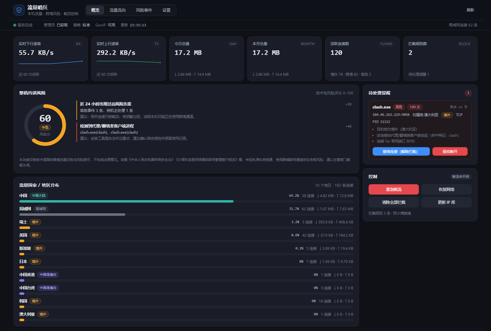
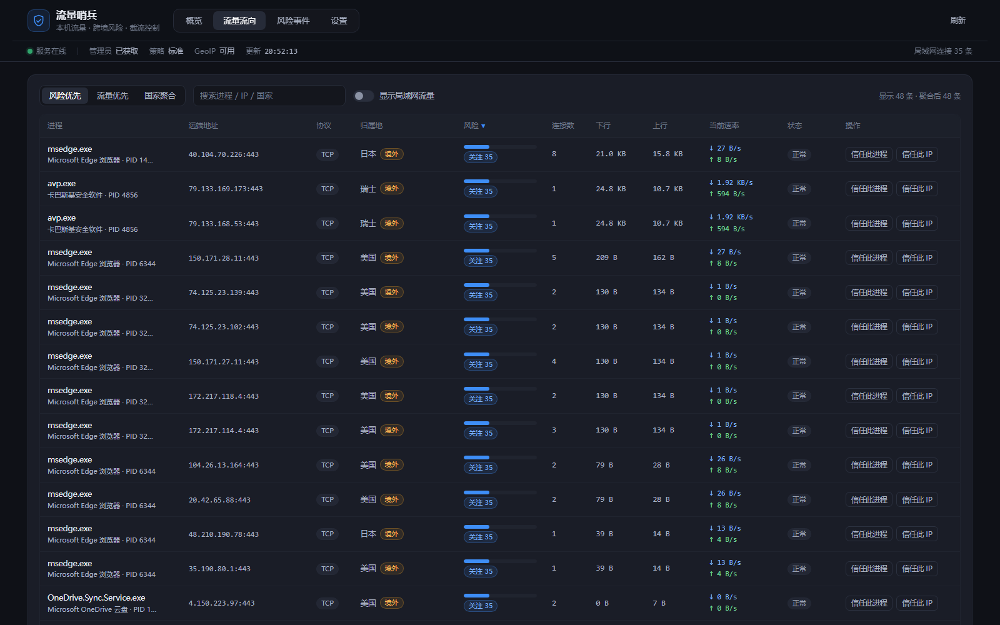
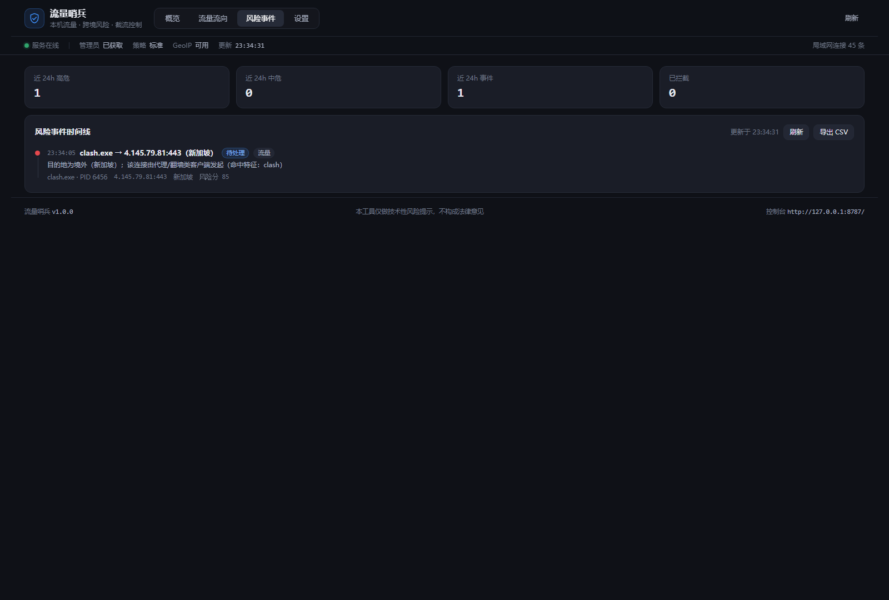
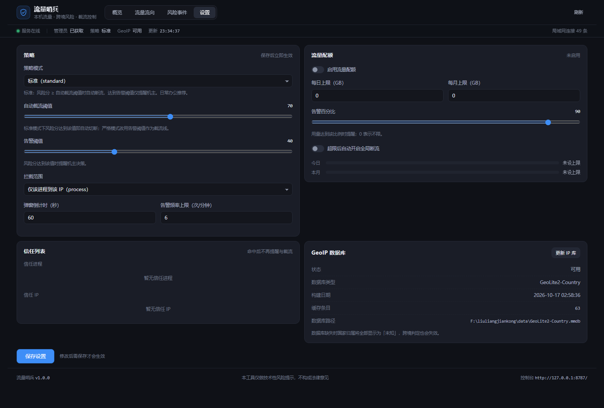
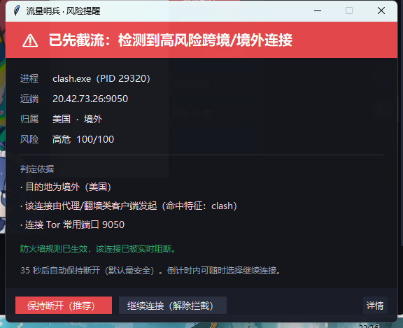
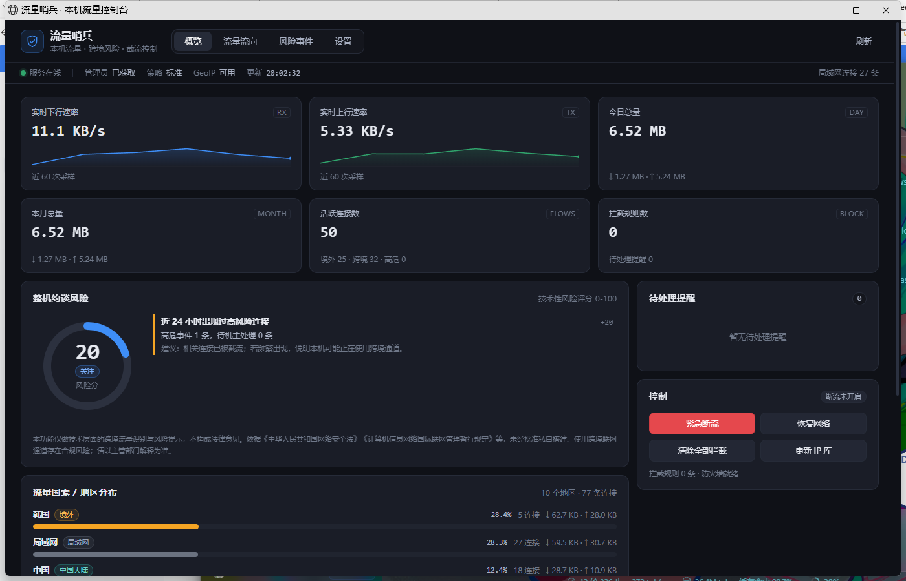

# 流量哨兵（TrafficGuard）

一台 Windows 电脑的**本机流量监控 + 跨境风险提示 + 自动截流**工具。

它回答四个问题：

1. **流量去哪了？** —— 每个进程连到哪个 IP、哪个国家/地区、什么端口、当前速率与累计字节。
2. **用了多少？** —— 实时上/下行、今日与本月总量、配额进度，超限可自动断流。
3. **是否流向海外/跨境？** —— 基于离线 GeoIP 库判定境外、中国港澳台、中国大陆、局域网。
4. **有没有被约谈的风险？** —— 综合「代理/翻墙客户端、隧道网卡、代理端口、境外 DNS、非常用端口」等因子打分；
   一旦达到高危阈值，**先截流、再弹窗告知，最后由机主决定「继续连接」还是「保持断开」**。

> ⚠️ **免责声明**：本程序只做技术层面的流量识别与风险提示，**不构成法律意见**，也不提供任何规避监管的功能。
> 相关合规要求（如《网络安全法》《计算机信息网络国际联网管理暂行规定》）请以主管部门解释为准。

> 📦 **2.0 版**：免安装单文件 exe（目标机不用装 Python）、独立程序窗口、系统托盘、绿色便携模式。
> **2.1 版**：流量流向表直接标出进程所属的应用程序（如 `avp.exe → 卡巴斯基安全软件`）。
> 版本差异见 [CHANGELOG.md](CHANGELOG.md)。

---

## 一、运行环境

| 项目 | 要求 |
| --- | --- |
| 系统 | Windows 10 / 11（x64，已在 26100 实测） |
| 分发方式 | **免安装 exe**（推荐，目标机无需 Python）或源码运行（需 Python 3.10+） |
| 权限 | 监控无需管理员；**自动截流需要管理员**（写入 Windows 防火墙规则），exe 已内置 UAC 清单自动提权 |
| 磁盘 | 约 25 MB（首次运行会下载约 3.4 MB 的 IP 归属库，见「GeoIP 数据与许可」） |

## 二、快速开始

### 方式一：免安装 exe（推荐，给别的机器用）

1. 把 `TrafficGuard.exe` 拷到目标机器任意目录（桌面、U 盘都行）。
2. 双击运行 → UAC 点「是」。
3. 自动弹出**独立程序窗口**「流量哨兵 · 本机流量控制台」，任务栏与托盘各有图标。
4. 首次运行会自动下载 IP 归属库（约 3.4 MB），之后完全离线可用。
5. 关闭窗口不会退出程序（托盘里继续跑、继续弹窗）；右键托盘 → 退出。

数据默认写在 `%LOCALAPPDATA%\TrafficGuard`，删掉 exe 即可卸载。

### 方式二：绿色/便携模式

在 exe 同目录放一个空文件 `portable.flag`（或启动时加 `--portable`），
配置、数据库、日志、IP 库全部写在 `程序目录\data`，整个文件夹可直接拷走。

### 方式三：源码运行（开发/调试）

1. 双击 **`start.bat`** —— 会弹出 UAC，点「是」以管理员身份运行。
2. 启动后自动打开独立窗口：<http://127.0.0.1:8787/>
3. 停止：`stop.bat`。

```bat
python run.py                :: 自动提权
python run.py --no-window    :: 不打开窗口，只托盘 + 弹窗
python run.py --no-elevate   :: 不提权，仅监控（不能截流）
python run.py --portable     :: 数据写在程序目录
python run.py --check        :: 环境自检
```

### 托盘菜单

`打开控制台` / `待处理提醒 N 条` / `紧急断流（全部公网）` / `恢复网络` / `退出流量哨兵`。


## 三、界面

**概览**：实时速率与今日/本月总量、整机约谈风险仪表、国家/地区分布、待处理提醒、紧急控制。



**流量流向**：按「进程 + 远端 IP + 端口」聚合，可按风险/流量/国家排序与搜索，支持一键信任。



**风险事件**：时间线 + 统计 + 导出 CSV。



**设置**：策略模式、阈值、配额、信任列表、GeoIP 库更新。



**弹窗（先截流后告知，由机主决定）**：



**2.0 的独立程序窗口**（Edge `--app` 模式，无地址栏、独立任务栏图标、可用托盘菜单控制）：



| 标签页 | 内容 |
| --- | --- |
| **概览** | 实时速率、今日/本月总量、配额进度、整机约谈风险仪表与分项、国家/地区分布条形图、待处理提醒、紧急控制 |
| **流量流向** | 按「进程 + 远端 IP + 端口」聚合的连接表；进程下方标出**所属应用**（如 `avp.exe → 卡巴斯基安全软件`），可按风险/流量/国家排序、搜索、一键信任进程或 IP |
| **风险事件** | 时间线形式的风险事件（含已拦截/已继续/超时/已抑制），支持导出 CSV |
| **设置** | 策略模式、阈值、拦截范围、弹窗倒计时、流量配额、信任列表、GeoIP 库信息与更新 |

## 四、风险判定模型

每条连接独立评分（0–100），命中即累加：

| 因子 | 权重 | 说明 |
| --- | --- | --- |
| 目的地为境外 | +35 | GeoIP 判定为除中国大陆以外的国家/地区 |
| 目的地为中国港澳台 | +20 | 属跨境链路，但法律定性不同，单独降级 |
| 归属地无法识别 | +22 | 私有库缺失或 Anycast 段 |
| 由代理/翻墙类客户端发起 | +50 | 进程名命中 clash / v2ray / xray / sing-box / shadowsocks / tor … |
| 连接 Tor 常用端口 | +50 | 9001/9030/9050/9051/9150 等 |
| 连接代理/VPN 常用端口 | +40 | 1080/7890/8388/51820/1194 等 |
| 直接用境外公共 DNS | +25 | 8.8.8.8、1.1.1.1、9.9.9.9 等（易造成解析泄漏与跨境访问） |
| 跨境 + 非常用端口 | +10 | 非 80/443/8080 等常见端口 |
| 代理进程 + 隧道网卡同时存在 | +10 | 交叉印证 |
| 命中局域网/保留地址 | 0 | 不计风险 |

**等级与动作**

| 分数 | 等级 | 默认动作（standard 模式） |
| --- | --- | --- |
| ≥ 70 | 高危 | **自动截流 + 弹窗**，由机主决定 |
| 40–69 | 中危 | 记录事件，控制台高亮，不拦截 |
| 20–39 | 关注 | 仅记录 |
| < 40 | 正常 | 仅记录 |

**三种模式**

- `standard`（默认）：只对 ≥70 的高危连接自动截流，日常境外浏览（如 GitHub、OneDrive）不会被误伤。
- `strict`：≥40 即截流，境外访问更严格，可能影响正常海外网站使用。
- `monitor`：只监控与告警，**永不拦截**。

**整机约谈风险指数**（概览页仪表）：在「本机是否在运行代理客户端 / 是否监听代理端口 / 是否存在隧道网卡 / 系统代理是否开启」等环境发现上加权，
与单条连接的评分相互独立。

> 判定依据是**进程名、端口、目的地归属**这类可解释特征，不做深度包检测。名字容易被改名规避，因此它更适合「如实反映本机状态」，
> 而不是对抗性检测。

## 五、截流机制

- 通过 `netsh advfirewall firewall add rule` 写入**出站阻止**规则，规则名统一为 `TG-*`，便于识别与清理。
- 默认作用域是「**该进程 → 该远端 IP**」（`policy.block_scope = process`），不会误伤同机其它程序；
  改成 `any` 则拦截所有进程到该 IP。
- 规则在程序退出后**仍然生效**（这是刻意的：截流不应因为关掉界面而失效）。可在「设置 → 清除全部拦截」一键清理。
- **全局断流（熔断）** 只封锁公网 IPv4 段与 IPv6 `2000::/3`，保留 `10/8`、`172.16/12`、`192.168/16`、`127/8`、`169.254/16` 与 ULA/链路本地，
  因此断流后局域网共享、打印机、本机回环仍然可用，也不会把控制台自己锁死。
- `svchost.exe`、`lsass.exe`、`services.exe` 等系统关键进程**永不自动拦截**，只提示，避免整机断网。
- 无管理员权限时不会伪造成功：界面会明确显示「未获得管理员权限，仅监控」，弹窗也会标注「自动截流未生效」。
- 若安装了第三方防火墙（如 Kaspersky、火绒），其规则可能覆盖 Windows 防火墙，请在第三方防火墙中放行/校验。

## 六、数据与隐私

- **全部数据只留在本机**：`data/traffic.db`（事件与每日流量）、`data/config.json`（配置）、`data/state.json`（拦截规则与信任记录）、`data/logs/`（日志）。
- 唯一的外网请求是**下载/更新 IP 归属库**（仅在点击「更新 IP 库」或首次缺库时发生），可在配置里关闭 `geoip.auto_download`。
- 程序不上传任何流量内容、进程列表或统计结果。控制台只监听 `127.0.0.1`，写操作需要页面内嵌的随机令牌（`X-TG-Token`）。

## GeoIP 数据与许可

- 本仓库**不包含** MaxMind 的 `GeoLite2-Country.mmdb`：该库受 [MaxMind GeoLite2 EULA](https://www.maxmind.com/en/geolite2/eula) 约束，
  不允许随代码再分发，只允许使用者自行获取。
- 首次启动时程序会自动下载一份到本地数据目录；你也可以：
  - 在 `data/config.json` 里填 `geoip.maxmind_license_key`，或设置环境变量 `MAXMIND_LICENSE_KEY`，
    程序会优先走 **MaxMind 官方直链**（推荐，也最合规）；
  - 或用 `python tools/update_geoip.py` 手动更新。
- 默认的镜像地址是社区维护的第三方镜像，仅为方便；商业/公开分发场景请自行替换为你自己的合规来源。
- 如需完全可再分发的数据，可自行替换为 [DB-IP Lite](https://db-ip.com/db/download/ip-to-country-lite)（CC BY 4.0，需署名），
  把 mmdb 放到数据目录并把 `geoip.db_path` 指向它即可。

## 七、配置项（`data/config.json`）

| 键 | 默认 | 说明 |
| --- | --- | --- |
| `server.port` | 8787 | 控制台端口（只绑定 127.0.0.1） |
| `monitor.sample_interval` | 2.0 | 采样间隔（秒） |
| `policy.mode` | standard | standard / strict / monitor |
| `policy.auto_block_enabled` | true | 是否允许自动截流 |
| `policy.auto_block_threshold` | 70 | 自动截流阈值 |
| `policy.alert_threshold` | 40 | 记录为风险的阈值 |
| `policy.block_scope` | process | process / any |
| `policy.alert_timeout_sec` | 60 | 弹窗倒计时，超时默认「保持断开」 |
| `policy.max_alerts_per_minute` | 6 | 弹窗频率上限，超出只记录不弹窗 |
| `policy.hmt_as_domestic` | false | 是否把港澳台并入「中国大陆」 |
| `quota.enabled` / `daily_gb` / `monthly_gb` | false / 0 / 0 | 流量配额（GB，0 表示不限） |
| `quota.warn_percent` | 90 | 配额告警百分比 |
| `policy.auto_kill_switch_on_quota` | false | 超配额是否自动全局断流 |
| `whitelist.processes` / `whitelist.ips` | [] | 信任名单（永不判定风险） |
| `whitelist.trust_minutes` | 30 | 选择「继续连接」后该目标的免打扰时长 |
| `proxy.process_keywords` | 见文件 | 代理客户端进程特征词，可自行扩充 |
| `proxy.local_listen_ports` | 见文件 | 代理常用监听端口 |

改完保存即为热生效（后端每次采样会检测配置文件变化）。

## 八、开机自启

1. 右键 **`install_autostart.bat`** → 以管理员身份运行，会创建计划任务 `TrafficGuard`
   （登录触发、最高权限运行，因此开机后不会再弹 UAC）。
2. 取消：运行 **`uninstall_autostart.bat`**。

## 九、测试与自检

```bat
python run.py --check                 :: 环境自检
python -m unittest discover -s tests  :: 39 个单元/集成测试
python tools/update_geoip.py --check  :: 检查 IP 库
```

测试覆盖：MMDB 解析与归属判定、风险评分与等级、模式/白名单行为、防火墙规则生成（模拟模式，不会改系统）、
采样与流表、决策闭环、API 鉴权。

## 十、实机验证记录

2026-10-20 在本机（Windows 11 26100，管理员权限）用 `tools/live_firewall_check.py` 跑通了真实截流闭环，
17 项检查全部通过：

| 检查项 | 结果 | 说明 |
| --- | --- | --- |
| 目标挑选 | ✅ | 4.145.79.81（境外，可连通） |
| 拦截前连通性 | ✅ | 443 端口可连 |
| 写入规则 | ✅ | `TG-BLKIP-238fb2fee871`，`netsh` 返回「确定」 |
| 规则确认存在 | ✅ | `show rule` 可查到 |
| 规则生效 | ✅ | 同一连接被阻断（不可达） |
| 删除规则后恢复 | ✅ | 再次可连通 |
| 风险引擎判定 | ✅ | 疑似代理 + 境外 + Tor 端口 = 85 分 → 自动截流 |
| 提醒创建 | ✅ | 待机主决定 |
| 提醒内规则写入 | ✅ | `TG-BLK-6b981aed2c39` |
| 截流生效 | ✅ | 该进程到该 IP 不可达 |
| 机主选「继续连接」 | ✅ | 返回 ok |
| 解除后恢复连通 | ✅ | 立即可连 |
| 提醒队列清空 | ✅ | 无残留待办 |
| 清理全部规则 | ✅ | 0 条 `TG-*` 残留 |

复现命令（会弹一次 UAC）：

```bat
python tools/live_firewall_check.py
```

## 十一、已知限制

1. **逐连接字节是估算值**：Windows 没有向普通用户态暴露「每条 TCP 连接已传输字节」的稳定接口
   （`GetPerTcpConnectionEStats` 需要管理员且多数系统上被禁用）。本程序用「进程 IO 增量 × 连接数均分」估算，
   再按网卡实测总量归一；**网卡级总量是精确的**，进程/连接级用于排序与观察趋势。
2. 不做 DPI/协议指纹，只依据进程名、端口、目的地；改名的客户端可能漏判（可在设置里补充特征词）。
3. 不是内核驱动，不防绕过；管理员可以删除规则。
4. 仅在 Windows 上测试。

## 十二、目录结构

```
traffic_guard/        核心代码
  winapi.py           IP Helper / 进程信息（纯 ctypes）
  geoip.py            MMDB 读取器 + 归属判定
  risk.py             风险评分引擎
  firewall.py         防火墙规则（netsh）
  core.py             采样循环 / 流表 / 截流 / 决策
  alerts.py           tkinter 置顶弹窗（风险窗 / 通知窗）
  server.py           本机 HTTP API + 静态页
  window.py           独立程序窗口（Edge --app）
  tray.py             系统托盘（pystray）
  paths.py            资源目录 / 数据目录 / 便携模式
  app.py              装配与生命周期
web/                  控制台前端（原生 HTML/CSS/JS）
data/                 IP 库、配置、SQLite、日志（源码模式）
tests/                单元与集成测试
docs/api.md           API 契约
docs/screenshots/     界面截图
build.py              一键打包（图标、版本信息、PyInstaller）
releases/1.0/         1.0 源码包
releases/2.0/         2.0 发布包（exe / 便携 zip / 源码 zip / 使用说明）
run.py / stop.py      启动 / 停止
start.bat / stop.bat  双击即用（源码模式）
```

## 十三、自己打包

```bat
:: 一次性准备（构建环境与运行时隔离）
python -m venv .build-venv
.\.build-venv\Scripts\python -m pip install pyinstaller pystray pillow

:: 构建
.\.build-venv\Scripts\python build.py            :: 单文件 exe + 文件夹版
.\.build-venv\Scripts\python build.py --onefile  :: 只要单文件
.\.build-venv\Scripts\python build.py --onedir   :: 只要文件夹版
```

产物在 `dist/onefile/TrafficGuard.exe`（约 22 MB）与 `dist/onedir/TrafficGuard/`（约 46 MB，启动更快）。
exe 已带 `--uac-admin` 清单，双击即提权，无需再点一次「以管理员身份运行」。

## 十四、卸载

1. 托盘 → 退出；控制台「设置 → 清除全部拦截」清理防火墙规则
   （或手动 `netsh advfirewall firewall delete rule name=all`，先确认只删 `TG-*`）。
2. `uninstall_autostart.bat` 取消自启。
3. 删除 exe 与 `%LOCALAPPDATA%\TrafficGuard`（绿色版删程序目录）即可：
   不写注册表、不装服务、不留系统残留。

## 十五、许可证

- 本项目代码采用 **MIT License**，见 [LICENSE](LICENSE)。
- 第三方组件与数据：
  | 组件 | 许可证 | 说明 |
  | --- | --- | --- |
  | pystray | LGPL-3.0 | 系统托盘；以独立库形式使用，源码公开、可替换 |
  | Pillow | HPND | 托盘图标绘制 |
  | PyInstaller | GPL-2.0+（含例外条款） | 仅构建期使用，允许打包分发 |
  | Tcl/Tk | BSD 类 | tkinter 弹窗 |
  | GeoLite2-Country | MaxMind EULA | 不随仓库分发，由使用者自行获取 |
- 详细许可见 [THIRD_PARTY_NOTICES.md](THIRD_PARTY_NOTICES.md)。
- 使用范围：仅供**在自己的设备上**做本机流量观察与风险提示；请勿用于监控他人设备。
